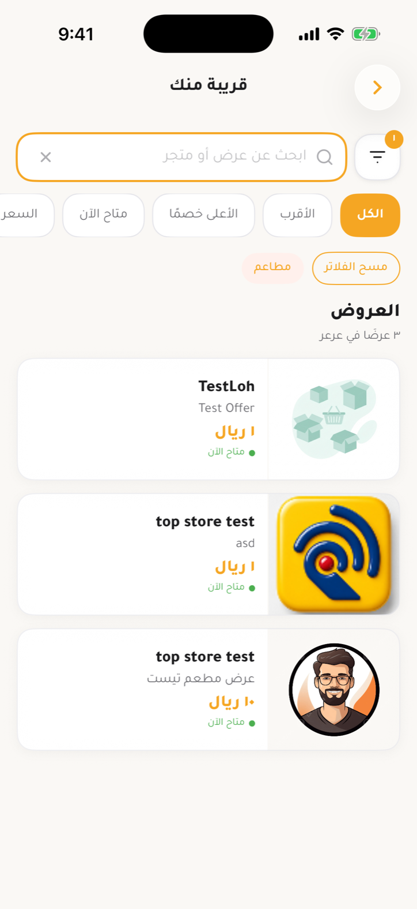
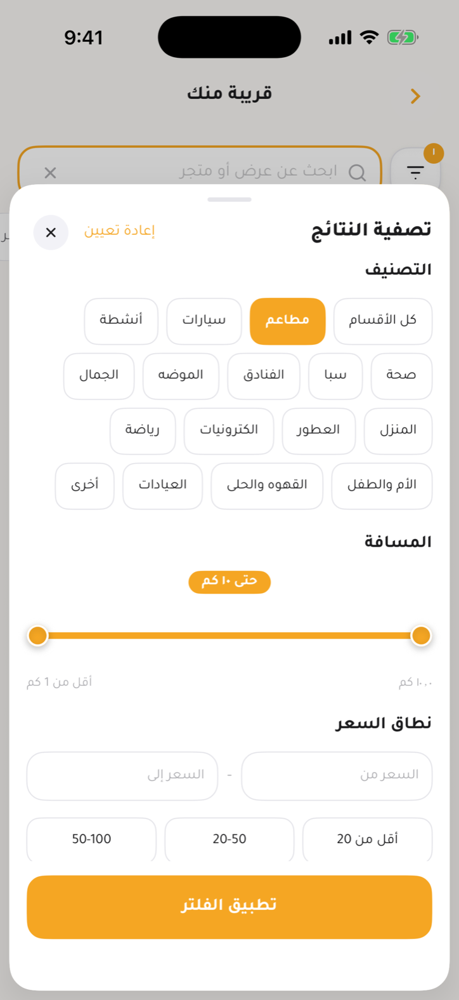
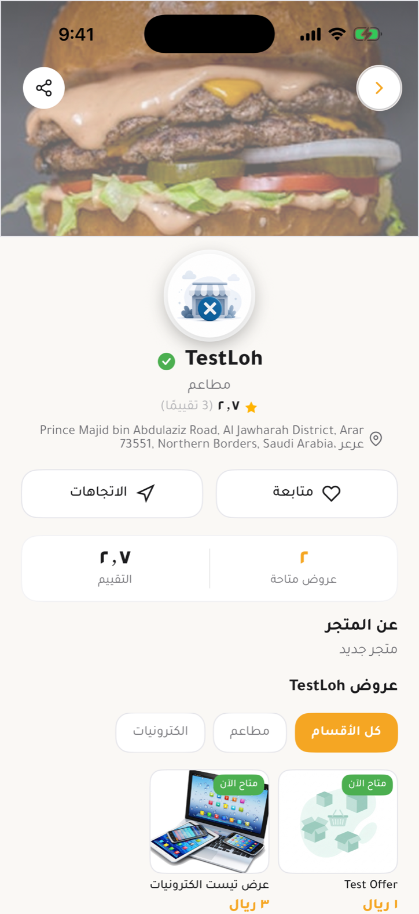

# LOH iOS App

LOH is a bilingual iOS app for discovering local offers and coupons. Users can explore nearby merchants, purchase offers, manage voucher codes, and keep track of their account and purchases.

## Features

- Browse offers by category, city, and proximity.
- Search and filter offers, and explore merchant pages.
- Save favorite offers and merchants.
- View offer details and complete checkout with available payment methods.
- Access purchased offers, voucher codes, purchase details, and ratings.
- Track cashback and receive notifications.
- Create and manage an account, payment cards, and support requests.
- Use the app in Arabic or English, with right-to-left layout support.

## Simulator screenshots

These screens were captured from the running app on an iPhone 17 Pro simulator (iOS 26.1). The app was using its Arabic locale. Each preview is kept compact; select an image to open it at full size.

<table>
  <tr>
    <th>Home and nearby offers</th>
    <th>Offer discovery</th>
    <th>Offer filters</th>
  </tr>
  <tr>
    <td></td>
    <td></td>
    <td></td>
  </tr>
  <tr>
    <td>Explore categories, promotions, nearby merchants, and cashback.</td>
    <td>Browse nearby deals, search merchants or offers, and sort results.</td>
    <td>Refine results by category, distance, price, discount, and availability.</td>
  </tr>
  <tr>
    <th>Offer details</th>
    <th>Merchant profile</th>
    <th></th>
  </tr>
  <tr>
    <td></td>
    <td></td>
    <td></td>
  </tr>
  <tr>
    <td>Review the offer price, validity, terms, location, and purchase option.</td>
    <td>View a merchant's rating, location, available offers, and follow option.</td>
    <td></td>
  </tr>
</table>

## Technology

- Swift 5 and SwiftUI, with UIKit integration where needed.
- MVVM with coordinator-based navigation.
- Async networking with `URLSession`, `async/await`, and `Codable`.
- Keychain-backed authentication storage.
- Swift Package Manager dependencies, including Firebase, Alamofire, Kingfisher, Lottie, IQKeyboardManager, and Google Maps.

## Project structure

```text
LOH/
├── App/             App features, organized by flow
├── Core/            App entry point, services, configuration, and assets
├── Coordinator/     App, authentication, and tab navigation
├── Networking/      API clients, endpoints, and response handling
├── Shared/          Reusable components, localization, and helpers
└── FCM/             Firebase Cloud Messaging support
Tests/               Project test files and test runners
```

## Requirements

- Xcode
- iOS 16.6 or later

## Run the app

1. Open `LOH.xcodeproj` in Xcode.
2. Select the `LOH` scheme and an iOS simulator or connected device.
3. Allow Xcode to resolve Swift Package Manager dependencies if prompted.
4. Build and run the app.

The app connects to LOH services. Some features may require a valid account, network access, and service-side configuration.
